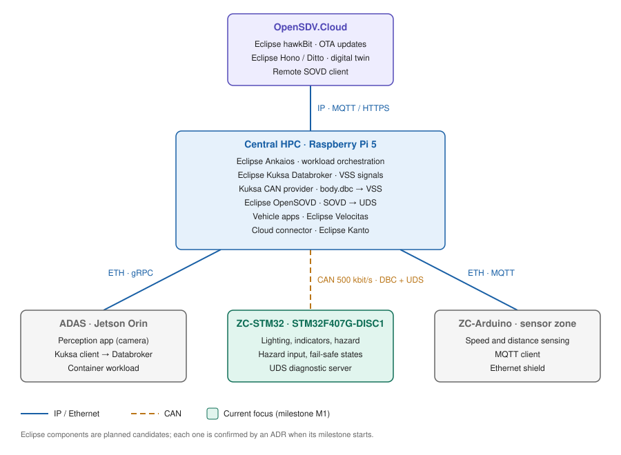

# Open SDV Bench

**A software-defined vehicle on your desk, built from hobby hardware and the Eclipse SDV stack, and engineered the way real automotive systems are: requirements → architecture → decisions → code → test.**

Open SDV Bench connects a cloud backend, a central vehicle computer, an ADAS domain and two zone controllers into one small but realistic vehicle E/E architecture. It mixes CAN and Ethernet, runs open-source Eclipse SDV components, and every function can be traced from a requirement down to a blinking LED on the bench.

> Status: **M0 – Foundation** (architecture and contracts before code). Next up: **M1**, bringing up the STM32 zone controller.



*Network and deployment view. The file is an editable draw.io diagram: open it in VS Code with the Draw.io Integration extension or at [app.diagrams.net](https://app.diagrams.net).*

## Why this project exists

"Software-defined vehicle" is easy to say and hard to show. This bench makes the core SDV ideas tangible, and each one is backed by a demo you can run:

| SDV principle | How the bench proves it |
|---|---|
| Hardware abstraction | Vehicle apps only talk to [COVESA VSS](https://covesa.github.io/vehicle_signal_specification/) signals in the Kuksa Databroker, never to CAN frames. Swap the real STM32 for its virtual twin and the app does not change. |
| Software-defined functions | Change how a vehicle function behaves by deploying a new app on the central computer, without reflashing any ECU. |
| Centralised compute + zone controllers | A central HPC runs the vehicle logic; zone controllers execute it close to sensors and actuators. |
| Mixed in-vehicle networks | CAN for deterministic, low-level signals; Ethernet for services and high-bandwidth data. |
| Cross-domain functions | The ADAS domain detects an obstacle, the HPC decides, a zone controller switches on the hazard lights. |
| Cloud connection and OTA | The vehicle reports to a cloud backend and receives software updates over the air. |
| Orchestration | Eclipse Ankaios starts, stops and updates vehicle workloads on the HPC. |
| Observability and diagnostics | Every node's health and faults are readable through SOVD (Eclipse OpenSOVD), locally or remotely. |
| Simulation first | Every hardware ECU gets a virtual twin, so the whole vehicle runs in CI without hardware. |

The end-to-end story the bench builds towards:

> A new app version is published in the cloud → delivered over the air → deployed on the HPC by Ankaios → it acts through VSS → the STM32 zone controller flashes the lights → a remote engineer verifies the result via SOVD.

## Architecture at a glance

| Node | Hardware | Role | Connected via |
|---|---|---|---|
| OpenSDV.Cloud | Laptop / cloud VM | OTA update server, digital twin, remote diagnostics | IP (MQTT / HTTPS) |
| Central HPC | Raspberry Pi 5 | Vehicle computer: VSS Databroker, vehicle apps, diagnostics gateway, orchestration | Hub of the bench |
| ADAS domain | NVIDIA Jetson Orin | Camera perception, publishes detections as VSS signals | Ethernet (gRPC) |
| ZC-STM32 | STM32F407G-DISC1 | Body zone controller: lighting, indicators, hazard, fail-safe, UDS server | CAN 500 kbit/s |
| ZC-Arduino | Arduino + Ethernet shield | Sensor zone controller: speed and distance sensing | Ethernet (MQTT) |

Planned Eclipse / open-source stack (each component is confirmed by an ADR when its milestone starts):

| Layer | Component |
|---|---|
| Vehicle abstraction | [Eclipse Kuksa](https://eclipse-kuksa.github.io/kuksa-website/) Databroker + CAN provider, COVESA VSS |
| Vehicle apps | [Eclipse Velocitas](https://eclipse.dev/velocitas/) (app development model) |
| Diagnostics | [Eclipse OpenSOVD](https://projects.eclipse.org/projects/automotive.opensovd) (SOVD → UDS) |
| Orchestration | [Eclipse Ankaios](https://eclipse-ankaios.github.io/ankaios/) |
| Cloud connection and OTA | Eclipse Kanto (vehicle side), Eclipse hawkBit, Hono / Ditto (cloud side) |

More detail: [architecture views](docs/architecture/README.md) · [network view](docs/architecture/network/README.md) · [deployment view](docs/architecture/deployment/README.md) · [decisions (ADRs)](docs/adr/).

## Roadmap

| | Milestone | Outcome |
|---|---|---|
| M0 | Foundation | Requirements, architecture, contracts, repo and tooling |
| M1 | Body zone controller on the bench | STM32 bring-up and light control over CAN (loopback) |
| M2 | Walking skeleton | VSS signal → Kuksa → CAN → STM32, end to end |
| M3 | Classic diagnostics | UDS server on the STM32 zone controller |
| M4 | Service-oriented diagnostics | Faults readable via Eclipse OpenSOVD REST |
| M5 | Vehicle function | Emergency brake → hazard lights, with the Arduino sensor zone, traced to requirements |
| M6 | ADAS domain | Jetson perception feeds the Databroker over Ethernet |
| M7 | Orchestration | Eclipse Ankaios manages vehicle functions |
| M8 *(proposed)* | Cloud and OTA | OpenSDV.Cloud: over-the-air app updates and remote SOVD access |

Progress is logged in the [devlog](docs/devlog.md).

## Repository layout

| Path | Contents |
|---|---|
| `docs/` | Requirements, architecture views, ADRs, hardware, Spec Kit inputs, devlog |
| `interfaces/` | Contracts: CAN (DBC), VSS, diagnostics |
| `specs/` | Spec Kit feature specifications |
| `ecus/` | Firmware: body zone (STM32), sensor zone (Arduino), virtual twins |
| `hpc/`, `adas-jetson/`, `deploy/` | Central computer, ADAS domain, deployment (later milestones) |
| `tests/` | System and integration tests |
| `tools/` | Helper scripts (e.g. CAN code generation) |

## Quickstart

```bash
# Inspect the CAN contract
pip install cantools
python3 -m cantools dump interfaces/can/body.dbc

# Generate the C pack/unpack code for the STM32 zone controller from the DBC
./tools/gen_can.sh
```

Or open the repo in VS Code and choose **Reopen in Container**; all tools come preinstalled.
Firmware flashing (STM32Cube for VS Code, ST-LINK over USB) runs on your host, not in the container.

## How this project is built

- **Contracts first**: CAN, signal and diagnostic interfaces are defined in `interfaces/` before any implementation.
- **Spec-driven development** with [GitHub Spec Kit](https://github.com/github/spec-kit) (pinned to v1.1.3): each feature goes from spec → plan → tasks → implementation, then verification on real hardware. Inputs for each spec are kept in `docs/spec-inputs/`.
- **Decisions are recorded** as ADRs in `docs/adr/`.
- **Views like an E/E architecture tool**: requirements, logical, software, network and deployment views in `docs/architecture/`.
- Rules for AI coding assistants: [AGENTS.md](AGENTS.md).

## Follow along

Star or watch the repo to follow the build. Each milestone ends with something you can see on the bench, and the reasoning behind each step is in the ADRs and the devlog. Ideas and questions are welcome as GitHub issues.

## License

[MIT](LICENSE)
