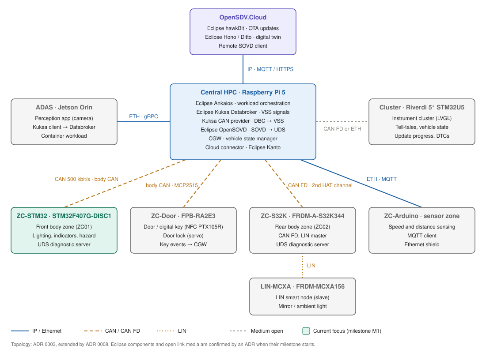

# Network / topology view

Physical view of the bench: which nodes exist, how they are connected, and which protocol runs on each link. Decision record: [ADR 0003](../../adr/0003-bench-network-topology.md).

The diagram is an editable draw.io file (`network-topology.drawio.svg`): open it in VS Code with the *Draw.io Integration* extension or at [app.diagrams.net](https://app.diagrams.net), edit, save. GitHub renders the same file as an image.

## Topology

A **central HPC star**: the Raspberry Pi 5 is the hub. Every zone controller and domain computer has one link to it, and the cloud connects through it. Each link uses the medium that fits its job:

- **Ethernet / IP** where services, containers or larger data are exchanged (cloud, ADAS, sensor zone).
- **CAN** where a small, deterministic, cyclic signal set and classic diagnostics are needed (body zone).

## Nodes

| Node | Hardware | Role | Interfaces |
|---|---|---|---|
| OpenSDV.Cloud | Laptop or cloud VM | OTA update server, digital twin, remote diagnostics client | IP |
| Central HPC | Raspberry Pi 5 | Vehicle computer: VSS Databroker, vehicle apps, SOVD gateway, orchestration, cloud connector | Ethernet, Wi-Fi, CAN (via HAT) |
| ADAS domain | NVIDIA Jetson Orin | Camera perception, publishes detections as VSS signals | Ethernet |
| ZC-STM32 | STM32F407G-DISC1 | Body zone controller: lighting, indicators, hazard, fail-safe, UDS server | CAN (bxCAN + 3.3 V transceiver) |
| ZC-Arduino | Arduino + Ethernet shield | Sensor zone controller: speed and distance sensing | Ethernet |

## Links

| Link | Medium | Protocol (planned) | Carries | Milestone |
|---|---|---|---|---|
| Cloud ↔ HPC | IP (Wi-Fi uplink, like a vehicle's cellular link) | MQTT / HTTPS | Telemetry, OTA packages, remote SOVD | M8 (proposed) |
| HPC ↔ ZC-STM32 | CAN classic, 500 kbit/s, 120 Ω at both ends | Signals per `interfaces/can/body.dbc`; UDS over ISO-TP | Light commands and status, diagnostics | M1 (loopback), M2 (real bus), M3 (UDS) |
| HPC ↔ ADAS | Ethernet | gRPC (Kuksa Databroker API) | Detected objects as VSS signals | M6 |
| HPC ↔ ZC-Arduino | Ethernet | MQTT (lightweight, fits a small MCU) | Speed and distance signals | M5 |

## Open points

- **Arduino model**: the exact model decides whether an Ethernet shield (e.g. W5500) is needed and how much protocol fits into its RAM. To be filled in `docs/hardware/bom.md`.
- **Ethernet ports**: the Pi 5 has one Ethernet port. With the Jetson and the Arduino on Ethernet, either a small unmanaged switch is added, or the cloud link uses the Pi's Wi-Fi (preferred, mirrors the vehicle's cellular uplink).
- **Protocols per link** are planned, not final. Each is confirmed by an ADR when its milestone starts.

## Target topology (candidates, not decided)

The goal picture of the bench: the accepted star above plus **candidate nodes** from the boards collected at electronica 2026 ([BOM, candidate boards](../../hardware/bom.md)). Candidates are drawn dashed in [`target-topology.mmd`](target-topology.mmd) (rendered at the end of this page).

This section is an overview so that no idea gets lost. It is **not a decision**: ADR 0003 and the diagram above stay the accepted topology. A candidate becomes accepted only through its own ADR (from ADR 0008) when its milestone starts; then ADR 0003, the draw.io diagram, this section and the website topology change in the same pull request.

| Candidate node | Hardware | Idea | Link (open) | Issue |
|---|---|---|---|---|
| ZC02, rear zone | NXP FRDM-A-S32K344 | Rear indicators following the CGW vehicle state (one function across two zones); later HSE for secure boot / signed OTA | CAN FD on the second channel of the Pi's CAN HAT | [#18](https://github.com/santhosh-ing/Open_SDV_Bench/issues/18) |
| LIN smart node | NXP FRDM-MCXA156 | LIN slave under ZC02 (mirror, ambient light), or rest-bus / fault-injection node | LIN from ZC02 | [#19](https://github.com/santhosh-ing/Open_SDV_Bench/issues/19) |
| Instrument cluster | Riverdi 5″ STM32U5 display, LVGL | Tell-tales, vehicle state, update progress, DTCs. Open: display only, or also the state-setting dashboard of ADR 0006 | CAN FD or Ethernet, to be checked | [#20](https://github.com/santhosh-ing/Open_SDV_Bench/issues/20) |
| Door / digital key | Renesas FPB-RA2E3 + PTX105R NFC + SG90 servo | Valid NFC card unlocks the door and enables Off → On; DTC on repeated invalid cards | CAN via MCP2515 (SPI) or UART to ZC02, to be checked | [#21](https://github.com/santhosh-ing/Open_SDV_Bench/issues/21) |

## Function-to-node mapping

See the [deployment view](../deployment/README.md).
