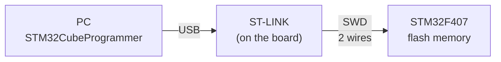
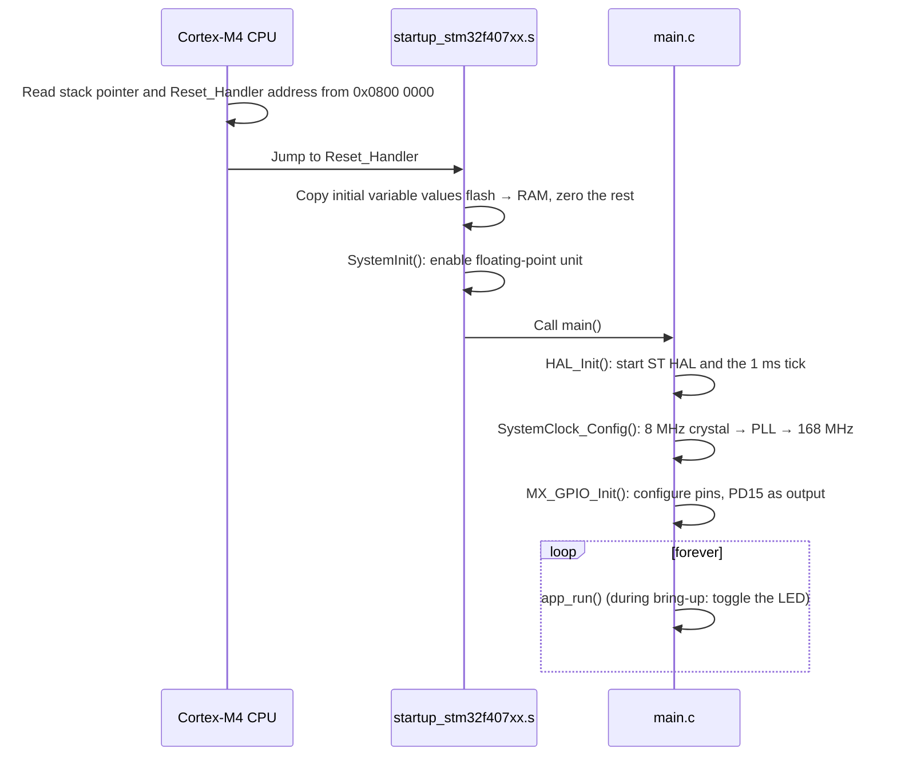
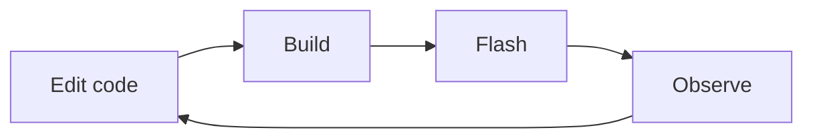
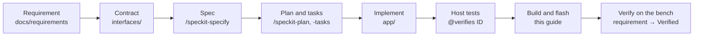

# From code to blinking LED: the firmware workflow

What happens between writing C code on your laptop and an LED blinking on the STM32F407G-DISC1 body zone controller. This guide is for readers who are new to embedded development. The commands themselves are in [STM32 setup, build and flash](stm32-build-and-flash.md).

Numbers on this page come from the first blink build of `ecus/body-zone-stm32` (2026-10-11).

## The core idea

On a normal PC program, you build and run on the same machine. A microcontroller is a **separate, tiny computer**: a 168 MHz ARM Cortex-M4 with 1 MB of flash and 128 KB of RAM, no operating system, no keyboard, no screen. It can't compile anything itself.

So the work is split across two machines:

- Your **PC** turns C source code into ARM machine code. This is called *cross-compiling*, because the PC is x86 and the chip is ARM.
- A **USB debug probe** on the board (the ST-LINK) copies that machine code into the chip's flash memory.

From then on the chip runs the program by itself, every time it powers up, even with the USB cable unplugged.

## The pipeline at a glance

```mermaid
flowchart LR
    subgraph PC["On your PC (x86, Windows)"]
        direction TB
        S1["1 · STM32CubeMX<br/>.ioc → Core/, Drivers/,<br/>startup .s, linker .ld"]
        S2["2 · You write C code<br/>app/ + main.c USER CODE"]
        S3["3 · CMake (configure)<br/>CMakeLists.txt → build.ninja"]
        S4["4 · Ninja + arm-none-eabi-gcc<br/>.c → .o → body-zone-stm32.elf"]
        S1 --> S2 --> S3 --> S4
    end

    subgraph BOARD["On the board (ARM, STM32F407)"]
        direction TB
        B5["5 · Flash memory<br/>.elf written at 0x0800 0000, verified"]
        B6["6 · Reset and boot<br/>startup code → main()"]
        B7["7 · Main loop runs<br/>toggle PD15 → blue LED LD6"]
        B8["8 · Observe / debug<br/>LED, debugger, later CAN"]
        B5 --> B6 --> B7 --> B8
    end

    S4 -- "5 · flash<br/>USB → ST-LINK → SWD<br/>(STM32CubeProgrammer)" --> B5
```

| # | Step | Tool | Input → output | How often |
|---|---|---|---|---|
| 1 | Describe the hardware setup | STM32CubeMX | `.ioc` → `Core/`, `Drivers/`, startup file, linker script | When the hardware setup changes |
| 2 | Write application code | VS Code | Your ideas → `app/` | Every feature |
| 3 | Plan the build (configure) | CMake | `CMakeLists.txt` → `build/Debug/build.ninja` | When files or settings change |
| 4 | Compile and link | Ninja + `arm-none-eabi-gcc` | `.c` → `.o` → `.elf` | Every change |
| 5 | Flash | STM32CubeProgrammer via ST-LINK | `.elf` → chip flash | Every change |
| 6 | Boot | The chip itself | Reset → `main()` | Every reset / power-up |
| 7 | Run | The chip itself | Main loop runs forever | Continuously |
| 8 | Verify | You, a debugger, tests | Observations → requirement status | Every change |

## Each step explained

### 1. Describe the hardware setup (STM32CubeMX)

The chip has hundreds of configurable settings: which pins are outputs, how the clock is multiplied, which peripherals (CAN, timers) are on. STM32CubeMX is a graphical wizard. You click the settings, it saves them in `body-zone-stm32.ioc`, and it **generates C code** that applies them at startup.

| | |
|---|---|
| Generates | `Core/` (`main.c`, init code), `Drivers/` (ST's HAL library), `startup_stm32f407xx.s`, `STM32F407xx_FLASH.ld`, `cmake/stm32cubemx/` |
| Example | Clock: 8 MHz crystal ÷ 4 × 168 ÷ 2 = **168 MHz**. Pin PD15 set as an output for the blue LED. |
| Rule | Never hand-edit this output. Change the `.ioc` and regenerate ([AGENTS.md](../../AGENTS.md), rule 3). |

*Analogy: an electrical plan for a building. It says where every wire goes before anyone moves in.*

### 2. Write the application code (`app/`)

This is the actual vehicle behaviour: indicators, hazard lights, CAN messages. `main.c` only calls `app_init()` once and `app_run()` in its main loop. Everything else lives in `app/`, in layers that only call downward ([ADR 0001](../adr/0001-use-autosar-inspired-layering.md)). Pure logic in `app/functions/` never touches hardware directly, which is why it can also be tested on your PC without the board.

### 3. Plan the build (CMake)

A firmware image is made from many files: your code, about 20 HAL driver files, a startup file, and a long list of compiler flags (which CPU, which floating-point unit, which optimisation level). Typing all of that by hand is error-prone. CMake reads a short description of the project and writes out the full step-by-step recipe.

| | |
|---|---|
| Reads | `CMakeLists.txt` (what to build), `CMakePresets.json` (Debug or Release), `cmake/gcc-arm-none-eabi.cmake` (use the ARM compiler, not the PC compiler) |
| Writes | `build/Debug/build.ninja` (the recipe) and `compile_commands.json` (lets VS Code understand your code) |
| Why CMake | The same project description works in VS Code, in a terminal, in GitHub CI and for the host unit tests. You're not locked into one IDE. |

During configure, CMake prints `Check for working C compiler … skipped`. That is expected: CMake normally tests a compiler by running a tiny program, but ARM code can't run on your PC.

*Analogy: a construction manager reading the architect's drawings and writing the task list for the crew. Nothing is built yet.*

### 4. Compile and link (Ninja + GCC)

Ninja executes the recipe. It runs two kinds of steps:

- **Compile.** Each `.c` file becomes an `.o` file containing ARM machine code. Each file is compiled on its own and doesn't yet know where in memory it will live.
- **Link.** The linker joins all `.o` files into one program. The linker script `STM32F407xx_FLASH.ld` is the chip's memory floor plan: code goes into flash at `0x0800 0000`, variables into RAM at `0x2000 0000`.

The result is `build/Debug/body-zone-stm32.elf` (machine code plus debug information), and `body-zone-stm32.map`, a report of where everything landed.

Ninja only redoes steps whose input files changed. Building twice in a row prints `ninja: no work to do`.

At the end, the linker reports how full the chip is. For the first blink build:

| Memory | Start address | Purpose | Used | Size | % |
|---|---|---|---:|---:|---:|
| FLASH | `0x0800 0000` | Program code and constants; keeps its content without power | 6 116 B | 1 MB | 0.58 % |
| RAM | `0x2000 0000` | Variables, stack, heap while running | 1 584 B | 128 KB | 1.21 % |
| CCMRAM | `0x1000 0000` | Extra fast RAM only the CPU can access | 0 B | 64 KB | 0 % |

Watch this table as features are added. It shows early if the firmware is running out of memory.

*Analogy: compiling is the factory making each part; linking is assembling them according to the floor plan.*

### 5. Flash it to the chip (ST-LINK, SWD)

The Discovery board carries two chips. The big one is the STM32F407. The small one near the USB connector is the **ST-LINK**, a debug probe. Your PC talks USB to the ST-LINK, and the ST-LINK talks **SWD** (Serial Wire Debug, ARM's two-wire debug link) to the main chip. Through SWD it can halt the CPU, erase flash, write new code and read memory.

Flash is like a small SSD inside the chip. Writing it means three steps: erase the old program, write the new one, read it back to verify. Then the programmer resets the chip so the new program starts.

### 6. The chip boots

There is no operating system. After every reset, the CPU follows a fixed sequence:

Firmware never exits. The main loop runs until power is removed.

### 7. Your code runs

During bring-up, the main loop toggles pin PD15 every 500 ms. PD15 is wired to the blue LED LD6, so it is on for half a second and off for half a second. The timing only comes out right if step 6 set the clock correctly, so a steady 0.5 s blink also confirms the clock setup.

This blink was a smoke test only. Project code calls `app_run()` from the main loop and does not use `HAL_Delay`.

### 8. Observe and verify

For the blink, you look at the LED. As the project grows, verification gets richer:

- a **debugger**: pause the chip, step line by line, inspect variables, through the same ST-LINK;
- **CAN messages** on the bus;
- **host unit tests** that check the logic on your PC before it ever reaches the board.

## The everyday loop

Steps 1 and 3 happen rarely. Day to day you go round this loop:

The commands for each step are in [STM32 setup, build and flash](stm32-build-and-flash.md#everyday-loop).

## Where this fits in the project

Build and flash is the last stretch of a longer chain, so that every LED blink traces back to a requirement:

See [AGENTS.md](../../AGENTS.md) for the rules behind each step and [docs/requirements](../requirements/README.md) for the requirement hierarchy.

## Glossary

| Term | Meaning |
|---|---|
| Firmware | The program that runs on a microcontroller. It's stored in flash and starts on power-up. |
| Toolchain | The set of programs that turn source code into firmware: compiler, assembler, linker. Here: GNU Tools for STM32 14.3.1. |
| Cross-compiler | A compiler that runs on one kind of CPU (your PC) and produces code for another (ARM). `arm-none-eabi-gcc` means: ARM target, no operating system, standard embedded calling rules. |
| HAL | Hardware Abstraction Layer. ST's C library, so code calls `HAL_GPIO_TogglePin()` instead of setting register bits by hand. Only `app/bsp/` and `app/com/` may call it. |
| `.elf` file | The finished program: machine code plus symbols and debug information. |
| Linker script (`.ld`) | The chip's memory floor plan: where flash and RAM start and how big they are. |
| `.map` file | Linker report listing where every function and variable was placed. |
| ST-LINK | The debug probe built into the Discovery board. It bridges USB from the PC to SWD on the chip. |
| SWD | Serial Wire Debug: ARM's two-wire link for flashing and debugging a running chip. |
| Flash | Non-volatile memory inside the chip that holds the program. |
| Debug / Release | Two build presets. Debug keeps code easy to step through; Release optimises for size and speed. |
| `cube-cmake`, `cube` | ST's wrappers that run CMake and the programmer with the tools from the STM32Cube bundle folder, so PATH doesn't need to be set by hand. |
